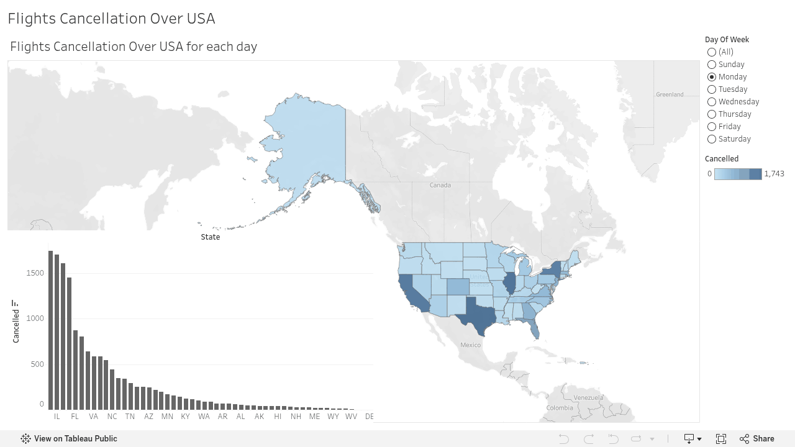
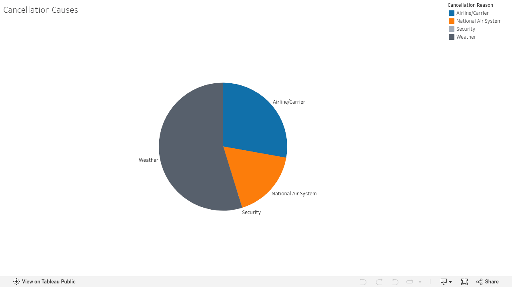
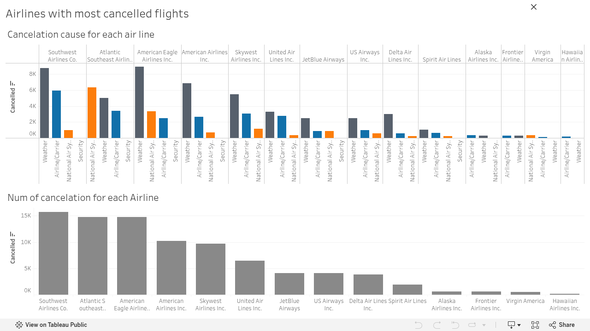

# Flight Delays & Cancellations Analysis (Tableau)

Analysis of 2015 US domestic flight data, focused on cancellations. The results are published as three interactive dashboards on Tableau Public.

## Dataset

2015 US domestic flights operated by large carriers ([Kaggle: 2015 Flight Delays and Cancellations](https://www.kaggle.com/usdot/flight-delays)). The raw CSV files are not stored in this repo because of their size. Cancellation reason codes are explained in [docs/cancellation_cause_codes.md](docs/cancellation_cause_codes.md).

## Dashboards (Tableau Public)

### 1. Flights Cancellation over USA

A map and a bar chart of cancelled flights by state, with a filter for the day of the week.

- Texas has the most cancellations on most days. Only on Sunday does Illinois overtake it.
- [Open the dashboard](https://public.tableau.com/app/profile/mohamed1902/viz/FlightsCancellationDashboard_16631860349350/FlightsCancellationOverUSA)



### 2. Cancellation Causes

A pie chart of all cancellation reasons.

- Weather is by far the largest cause (47,874 cancellations). Security is the smallest (22).
- [Open the dashboard](https://public.tableau.com/app/profile/mohamed1902/viz/CancellationCauses1/CancellationCauses)
- A second version of the same view as a bar chart: [open](https://public.tableau.com/app/profile/mohamed1902/viz/CancellationCauses_16631900389580/CancellationCauses)



### 3. Airlines with Most Cancelled Flights

Two bar charts: cancellations per airline, and the cause mix for each airline.

- Southwest Airlines Co. has the most cancellations (almost 16,000).
- Weather is the top cause overall, but for some airlines, like Atlantic Southeast Airlines, National Air System is the top cause.
- [Open the dashboard](https://public.tableau.com/app/profile/mohamed1902/viz/Airlineswithmostcancelledflights/Airlineswithmostcancelledflights)



## Design Notes

- One color that gets lighter or darker with the number of cancelled flights, on the map and the bar charts.
- Color-blind-friendly palettes for the charts with categories.
- Cancellation cause codes (A, B, C, D) renamed to full names so they are easy to read.

## Repo Structure

```
README.md
docs/
  Flight_Delays_Cancellations_Report.pdf   full write-up (3 pages)
  cancellation_cause_codes.md              what A, B, C, D mean
images/                                    screenshots of the dashboards
old/                                       the original README and PDF name
```

## Tools

- Tableau Public (dashboard design and publishing)
- 2015 US DOT flight data (Kaggle)
